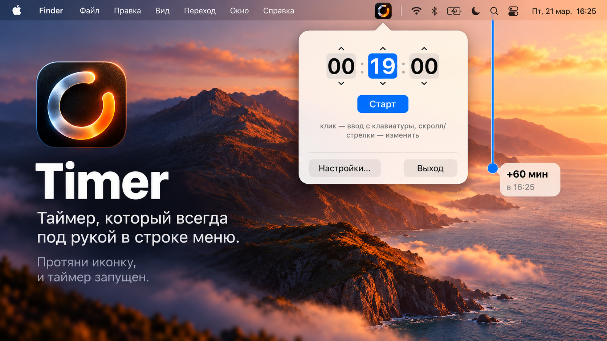

# Timer

**English** · [Русский](README.md)



A small countdown timer that lives in the macOS menu bar.

- Click the menu-bar icon to open the popover: type the time or use scroll / arrow keys, then press Start.
- Press and hold the icon and drag up/down to add or remove minutes while the timer is running.
- With Shift held, the drag steps by 5 minutes and snaps to :00, :05, :10… (toggle in Settings).
- Right-click the icon for the menu. Alert sound, volume and duration are in Settings.
- Hotkeys in the popover: `H` pause/resume, `C` reset (also work with the Russian layout).

The interface is in Russian only; there is no localization yet.

## For developers

### Requirements

macOS 14+, Swift 5.10 toolchain (Xcode or Command Line Tools).

### Build

```sh
./build.sh            # builds dist/Timer.app (universal arm64 + x86_64)
./build.sh --install  # same, then copies it into /Applications
open dist/Timer.app
```

The app is ad-hoc signed, not notarized. If macOS refuses to open a downloaded copy,
right-click it and choose Open, or run `xattr -dr com.apple.quarantine Timer.app`.

The app must run from the `.app` bundle (notifications and launch-at-login need a bundle id); `swift run` is not supported.

## License

[MIT](LICENSE)
